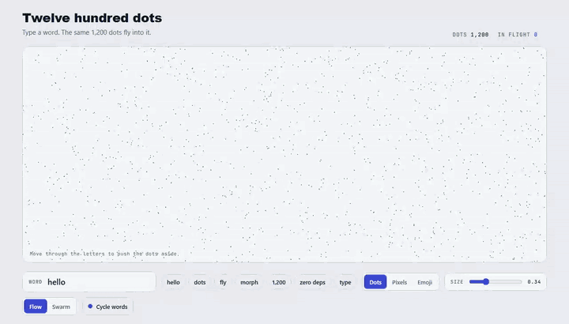
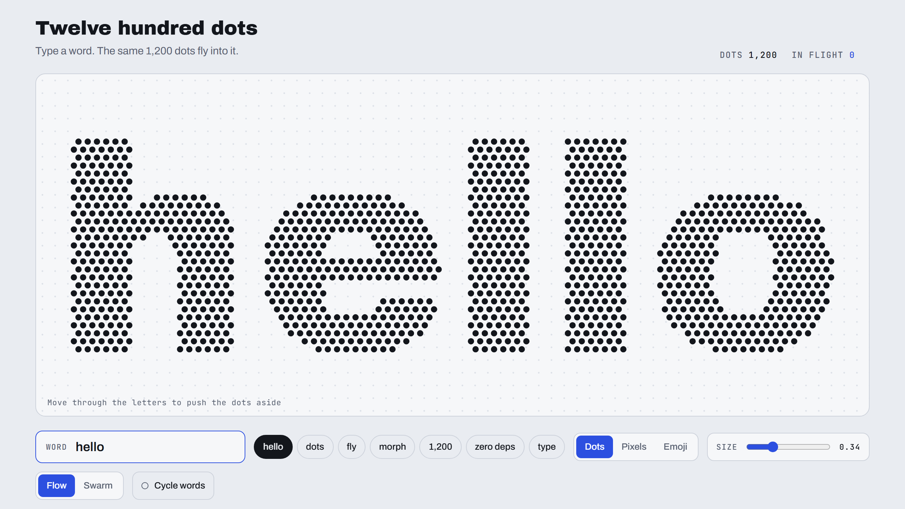
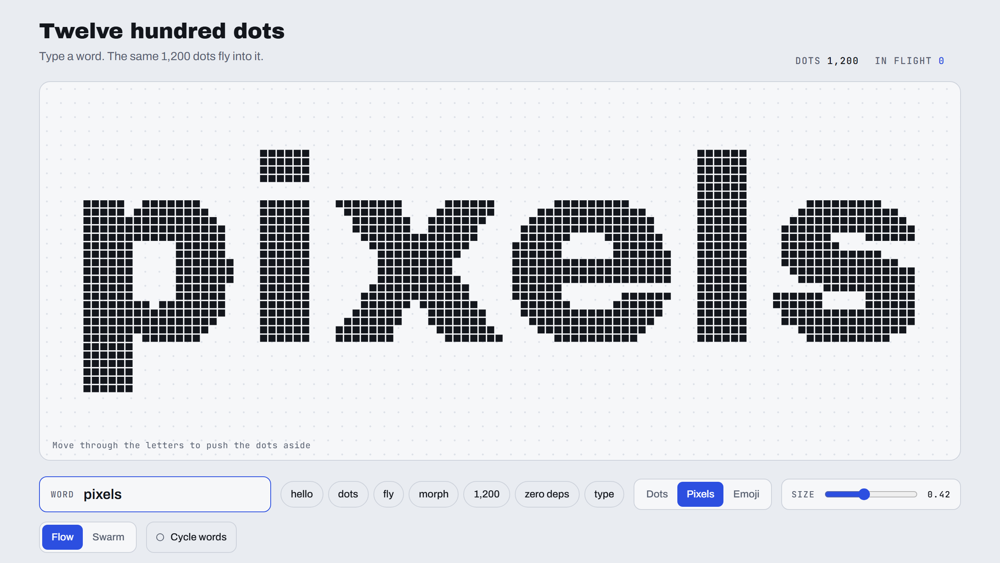
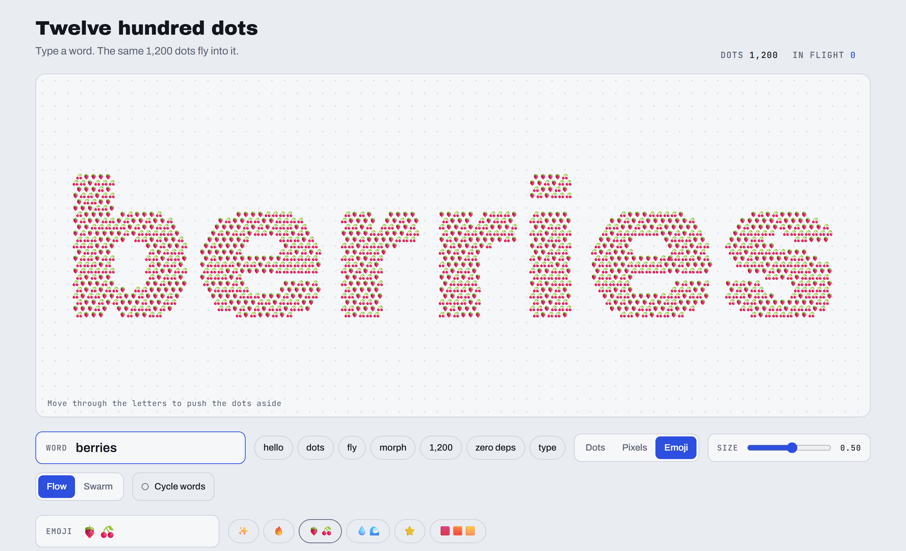
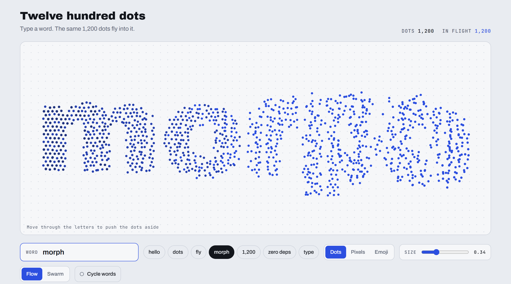
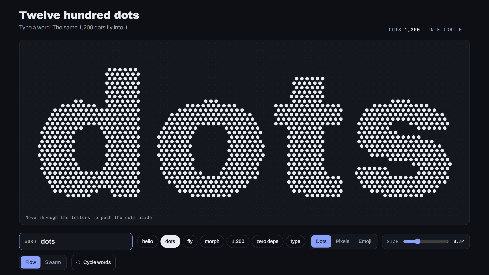

# dot-text

Text made of 1,200 dots. Change the word and the same dots fly into the next one.

One function, no dependencies, about 15 KB of plain JavaScript.

**[Live demo](https://yarooqh.github.io/dot-text/)**



| Dots | Pixels |
| --- | --- |
|  |  |
| **Emoji** | **Mid-flight** |
|  |  |



## Use it

Copy [`dot-text.js`](dot-text.js) into your project, or load it with a script tag.

```html
<canvas id="stage" style="width: 100%; height: 400px"></canvas>
<script src="dot-text.js"></script>
<script>
  const dots = dotText(document.getElementById("stage"), { count: 1200 });

  dots.set("hello");
  setTimeout(() => dots.set("world"), 3000); // same 1,200 dots, new word
</script>
```

The canvas takes its size from CSS and refits when it is resized. In a bundler, `module.exports` is set, so `const dotText = require("./dot-text.js")` works too.

`dotText(canvas, options)` returns:

| Member | |
| --- | --- |
| `set(text)` | Flies the dots into `text`. Calling it mid-flight redirects the dots from wherever they are. An empty string gathers them into a short line. |
| `options(patch)` | Changes any option except `count`. A new `shape` refits the current word right away, a new `dot` size resizes in place, and motion options apply to the next `set()`. |
| `destroy()` | Stops the animation and removes the canvas listeners. |
| `text` | The current word. |
| `count` | The number of dots. |

## Options

| Option | Default | |
| --- | --- | --- |
| `count` | `1200` | Number of dots. Fixed for the life of the canvas. |
| `font` | `"Archivo Black", "Arial Black", sans-serif` | Any font the page has loaded. Heavy faces work best. |
| `weight` | `400` | Font weight. |
| `shape` | `"circle"` | `"circle"` on a hex grid, `"square"` for pixels on a square grid, or `"emoji"`. |
| `emoji` | `"✨"` | For `shape: "emoji"`. One emoji, or several (`"🍓🍒"`) that the dots take in turn. |
| `dot` | by shape | Item size as a share of the grid spacing. `0.5` makes neighbors touch. Defaults: `0.34` circles, `0.42` squares, `0.5` emoji. |
| `padding` | `0.1` | Clear space around the text, as a share of the shorter side. |
| `duration` | `1000` | Flight time of one dot, in ms. |
| `stagger` | `450` | Spread of start times across the word, in ms. |
| `arc` | `0.3` | How far paths bow sideways, as a share of the distance. |
| `mode` | `"flow"` | `"flow"` keeps neighbors together while they fly. `"swarm"` shuffles every dot. |
| `color` | `"#111"` | Resting color. |
| `accent` | `"#3355ff"` | Color of a dot at mid-flight. Emoji are not tinted. |
| `pointer` | `true` | Dots move aside for the cursor. |
| `onTick` | `null` | Called with the number of dots in flight whenever it changes. |

```js
const dots = dotText(canvas, { shape: "emoji", emoji: "🔥", dot: 0.5 });
dots.options({ shape: "square", color: "#e24a30", mode: "swarm" });
```

## How it works

1. **Sampling.** The word is drawn once on a hidden canvas. A hex grid is laid over the letters and its spacing is tuned until as close to `count` points as possible land on the ink. Any dots left over stack on points spread through the word, so every word uses all of them.
2. **Pairing.** The old and new positions are each sorted left to right and cut into thin strips, then matched top to bottom inside each strip. Dots that start next to each other land next to each other, so the change reads as one movement.
3. **Flight.** Each dot follows its own bowed curve. Start times sweep across the word, dots shrink slightly and take the accent color in the air, and a new word can interrupt a flight at any point.

Circles and squares are batched into five fills, one per color step, instead of one draw per dot. Emoji are drawn once into small cached images and stamped.

## Performance

Measured in Chromium on a desktop machine, with 1,200 items on a 1180 × 605 canvas:

| | Dots | Pixels | Emoji |
| --- | --- | --- | --- |
| One frame during a flight (median) | 0.3 ms | 0.2 ms | 0.7 ms |
| `set()` to a new word (median) | 1.9 ms | 1.8 ms | not measured |

The animation loop stops when nothing is moving, so a settled word costs nothing. While the pointer is over the canvas the loop keeps running.

## Notes

- The text lives in canvas pixels, so give the canvas an `aria-label` that names the current word.
- With `prefers-reduced-motion: reduce`, flights shorten to 200 ms and run along straight lines.
- The word is sampled when you call `set()`, so the font has to be loaded by then. The demo waits with `document.fonts.load()` before its first word.
- The demo page, [`index.html`](index.html), loads its fonts from Google Fonts. The function itself makes no network requests.

## License

[MIT](LICENSE)
